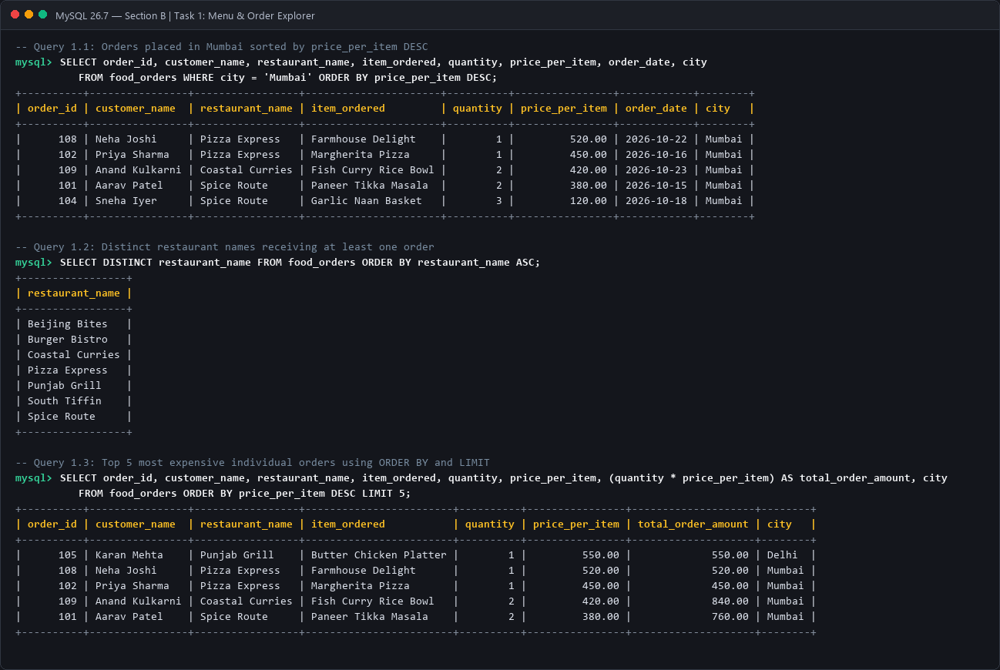
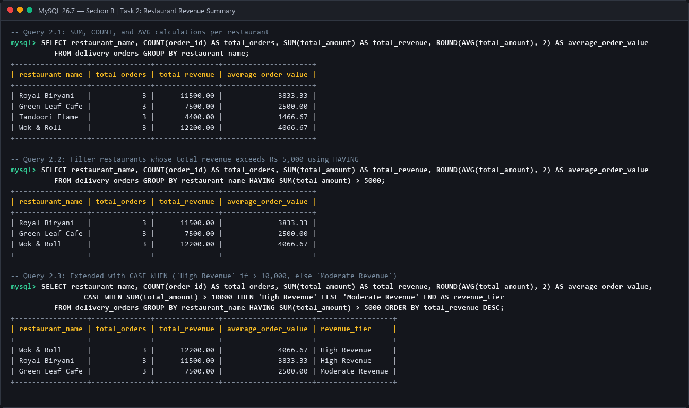
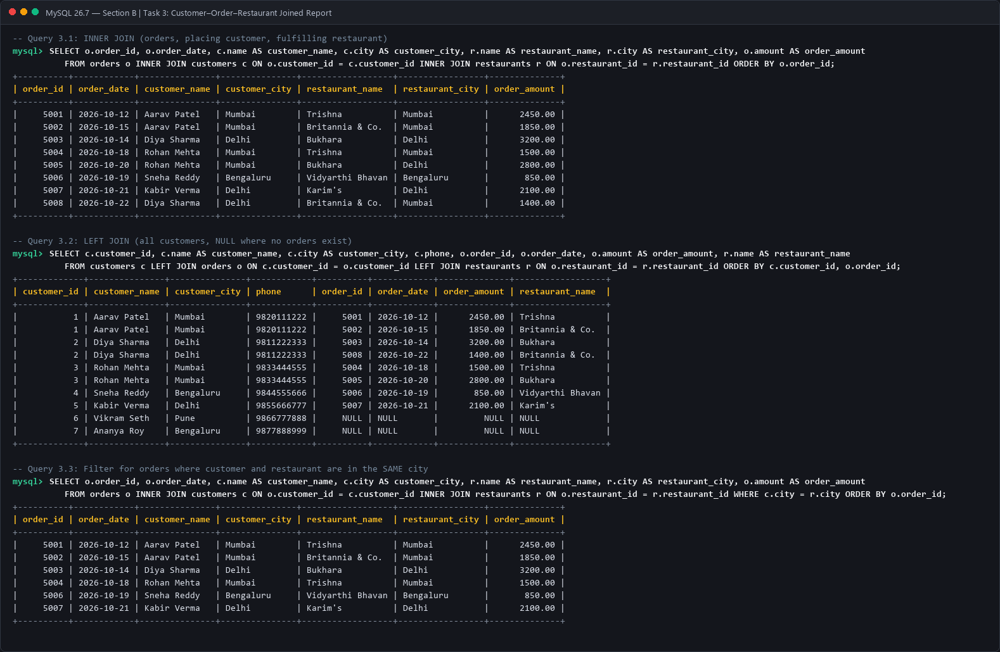
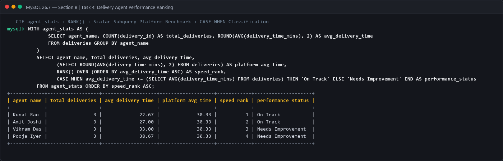

# Module 4: SQL for Data Analytics (M4-A1)
## Section B — Practical Coding Tasks

**Program:** Data Analytics  
**Course Code:** M4-A1  
**Database Engine:** MySQL 8.0+ / 26.7+  
**Database Name:** `section_b_food_analytics`  

---

### Task 1: Menu & Order Explorer

#### 1. Objective & Requirements
- Create table `food_orders` with columns: `order_id`, `customer_name`, `restaurant_name`, `item_ordered`, `quantity`, `price_per_item`, `order_date`, and `city`.
- Insert at least 8 rows spanning at least 3 cities.
- Write query 1: Retrieve all orders placed in 'Mumbai', sorted by `price_per_item` DESC.
- Write query 2: Return all distinct restaurant names that have received at least one order.
- Write query 3: List top 5 most expensive individual orders using `ORDER BY` and `LIMIT`.

#### 2. SQL Schema & Data Ingestion
```sql
CREATE TABLE food_orders (
    order_id INT PRIMARY KEY,
    customer_name VARCHAR(50) NOT NULL,
    restaurant_name VARCHAR(50) NOT NULL,
    item_ordered VARCHAR(50) NOT NULL,
    quantity INT NOT NULL,
    price_per_item DECIMAL(10,2) NOT NULL,
    order_date DATE NOT NULL,
    city VARCHAR(50) NOT NULL
);

INSERT INTO food_orders (order_id, customer_name, restaurant_name, item_ordered, quantity, price_per_item, order_date, city) VALUES
(101, 'Aarav Patel',    'Spice Route',     'Paneer Tikka Masala', 2, 380.00, '2026-10-15', 'Mumbai'),
(102, 'Priya Sharma',   'Pizza Express',   'Margherita Pizza',    1, 450.00, '2026-10-16', 'Mumbai'),
(103, 'Rohan Verma',    'Burger Bistro',   'Double Cheeseburger', 2, 280.00, '2026-10-17', 'Delhi'),
(104, 'Sneha Iyer',     'Spice Route',     'Garlic Naan Basket',  3, 120.00, '2026-10-18', 'Mumbai'),
(105, 'Karan Mehta',    'Punjab Grill',    'Butter Chicken Platter', 1, 550.00, '2026-10-19', 'Delhi'),
(106, 'Diya Nair',      'South Tiffin',    'Masala Dosa Combo',   2, 160.00, '2026-10-20', 'Bengaluru'),
(107, 'Vikram Malhotra','Beijing Bites',   'Schezwan Noodles',    2, 320.00, '2026-10-21', 'Bengaluru'),
(108, 'Neha Joshi',     'Pizza Express',   'Farmhouse Delight',   1, 520.00, '2026-10-22', 'Mumbai'),
(109, 'Anand Kulkarni', 'Coastal Curries', 'Fish Curry Rice Bowl',2, 420.00, '2026-10-23', 'Mumbai'),
(110, 'Pooja Reddy',    'Burger Bistro',   'Truffle Fries & Shake',1, 350.00, '2026-10-24', 'Delhi');
```

#### 3. Queries & Analysis

##### Query 1.1: Orders in 'Mumbai' Sorted by `price_per_item` DESC
```sql
SELECT order_id, customer_name, restaurant_name, item_ordered, quantity, price_per_item, order_date, city
FROM food_orders
WHERE city = 'Mumbai'
ORDER BY price_per_item DESC;
```

##### Query 1.2: Distinct Restaurants Receiving Orders
```sql
SELECT DISTINCT restaurant_name 
FROM food_orders
ORDER BY restaurant_name ASC;
```

##### Query 1.3: Top 5 Most Expensive Orders
```sql
SELECT order_id, customer_name, restaurant_name, item_ordered, quantity, price_per_item, (quantity * price_per_item) AS total_order_amount, city
FROM food_orders
ORDER BY price_per_item DESC
LIMIT 5;
```

#### 4. Query Output Screenshot


---

### Task 2: Restaurant Revenue Summary

#### 1. Objective & Requirements
- Create table `delivery_orders` with columns: `order_id`, `restaurant_name`, `city`, `total_amount`, `order_status`, `order_date`.
- Insert at least 10 rows covering at least 4 different restaurants.
- Calculate `SUM`, `COUNT`, and `AVG` for revenue, total orders, and average order value per restaurant.
- Filter using `HAVING` for total revenue exceeding Rs 5,000.
- Label qualifying restaurants using `CASE WHEN` ('High Revenue' if > 10,000, else 'Moderate Revenue').

#### 2. SQL Schema & Data Ingestion
```sql
CREATE TABLE delivery_orders (
    order_id INT PRIMARY KEY,
    restaurant_name VARCHAR(50) NOT NULL,
    city VARCHAR(50) NOT NULL,
    total_amount DECIMAL(10,2) NOT NULL,
    order_status VARCHAR(20) NOT NULL,
    order_date DATE NOT NULL
);

INSERT INTO delivery_orders (order_id, restaurant_name, city, total_amount, order_status, order_date) VALUES
(201, 'Royal Biryani',   'Mumbai',    3200.00, 'Delivered', '2026-10-01'),
(202, 'Royal Biryani',   'Mumbai',    4500.00, 'Delivered', '2026-10-03'),
(203, 'Royal Biryani',   'Mumbai',    3800.00, 'Delivered', '2026-10-06'),
(204, 'Green Leaf Cafe', 'Bengaluru', 2100.00, 'Delivered', '2026-10-02'),
(205, 'Green Leaf Cafe', 'Bengaluru', 2600.00, 'Delivered', '2026-10-07'),
(206, 'Green Leaf Cafe', 'Bengaluru', 2800.00, 'Delivered', '2026-10-12'),
(207, 'Tandoori Flame',  'Delhi',     1800.00, 'Delivered', '2026-10-04'),
(208, 'Tandoori Flame',  'Delhi',     1400.00, 'Delivered', '2026-10-10'),
(209, 'Tandoori Flame',  'Delhi',     1200.00, 'Delivered', '2026-10-15'),
(210, 'Wok & Roll',      'Mumbai',    4200.00, 'Delivered', '2026-10-05'),
(211, 'Wok & Roll',      'Mumbai',    4100.00, 'Delivered', '2026-10-11'),
(212, 'Wok & Roll',      'Mumbai',    3900.00, 'Delivered', '2026-10-16');
```

#### 3. Production Query with Aggregates, `HAVING`, and `CASE WHEN`
```sql
SELECT 
    restaurant_name,
    COUNT(order_id) AS total_orders,
    SUM(total_amount) AS total_revenue,
    ROUND(AVG(total_amount), 2) AS average_order_value,
    CASE 
        WHEN SUM(total_amount) > 10000 THEN 'High Revenue'
        ELSE 'Moderate Revenue'
    END AS revenue_tier
FROM delivery_orders
GROUP BY restaurant_name
HAVING SUM(total_amount) > 5000
ORDER BY total_revenue DESC;
```

#### 4. Query Output Screenshot


---

### Task 3: Customer–Order–Restaurant Joined Report

#### 1. Objective & Requirements
- Create three relational tables: `customers`, `restaurants`, and `orders`.
- Insert at least 6 rows per table, intentionally including at least 2 zero-order customers.
- Write query 1: `INNER JOIN` to list orders, placing customer names, and fulfilling restaurant names.
- Write query 2: `LEFT JOIN` to preserve all registered customers (displaying `NULL` for customers with no orders).
- Write query 3: Filter joined records with `WHERE` to show only orders where the customer and restaurant share the same city.

#### 2. SQL Schema & Data Ingestion
```sql
CREATE TABLE customers (
    customer_id INT PRIMARY KEY,
    name VARCHAR(50) NOT NULL,
    city VARCHAR(50) NOT NULL,
    phone VARCHAR(15) NOT NULL
);

CREATE TABLE restaurants (
    restaurant_id INT PRIMARY KEY,
    name VARCHAR(50) NOT NULL,
    cuisine_type VARCHAR(50) NOT NULL,
    city VARCHAR(50) NOT NULL
);

CREATE TABLE orders (
    order_id INT PRIMARY KEY,
    customer_id INT NOT NULL,
    restaurant_id INT NOT NULL,
    amount DECIMAL(10,2) NOT NULL,
    order_date DATE NOT NULL,
    FOREIGN KEY (customer_id) REFERENCES customers(customer_id),
    FOREIGN KEY (restaurant_id) REFERENCES restaurants(restaurant_id)
);

INSERT INTO customers (customer_id, name, city, phone) VALUES
(1, 'Aarav Patel',     'Mumbai',    '9820111222'),
(2, 'Diya Sharma',      'Delhi',     '9811222333'),
(3, 'Rohan Mehta',      'Mumbai',    '9833444555'),
(4, 'Sneha Reddy',      'Bengaluru', '9844555666'),
(5, 'Kabir Verma',      'Delhi',     '9855666777'),
(6, 'Vikram Seth',      'Pune',      '9866777888'), -- Zero orders
(7, 'Ananya Roy',       'Bengaluru', '9877888999'); -- Zero orders

INSERT INTO restaurants (restaurant_id, name, cuisine_type, city) VALUES
(101, 'Trishna',           'Seafood',     'Mumbai'),
(102, 'Bukhara',           'North Indian','Delhi'),
(103, 'Vidyarthi Bhavan',  'South Indian','Bengaluru'),
(104, 'Britannia & Co.',   'Parsi',       'Mumbai'),
(105, 'Karim\'s',          'Mughlai',     'Delhi'),
(106, 'The Permit Room',   'Fusion',      'Bengaluru');

INSERT INTO orders (order_id, customer_id, restaurant_id, amount, order_date) VALUES
(5001, 1, 101, 2450.00, '2026-10-12'),
(5002, 1, 104, 1850.00, '2026-10-15'),
(5003, 2, 102, 3200.00, '2026-10-14'),
(5004, 3, 101, 1500.00, '2026-10-18'),
(5005, 3, 102, 2800.00, '2026-10-20'),
(5006, 4, 103,  850.00, '2026-10-19'),
(5007, 5, 105, 2100.00, '2026-10-21'),
(5008, 2, 104, 1400.00, '2026-10-22');
```

#### 3. Queries & Analysis

##### Query 3.1: INNER JOIN
```sql
SELECT 
    o.order_id,
    o.order_date,
    c.name AS customer_name,
    c.city AS customer_city,
    r.name AS restaurant_name,
    r.city AS restaurant_city,
    o.amount AS order_amount
FROM orders o
INNER JOIN customers c ON o.customer_id = c.customer_id
INNER JOIN restaurants r ON o.restaurant_id = r.restaurant_id
ORDER BY o.order_id;
```

##### Query 3.2: LEFT JOIN Preserving Inactive Customers
```sql
SELECT 
    c.customer_id,
    c.name AS customer_name,
    c.city AS customer_city,
    c.phone,
    o.order_id,
    o.order_date,
    o.amount AS order_amount,
    r.name AS restaurant_name
FROM customers c
LEFT JOIN orders o ON c.customer_id = o.customer_id
LEFT JOIN restaurants r ON o.restaurant_id = r.restaurant_id
ORDER BY c.customer_id, o.order_id;
```

##### Query 3.3: Same City Order Matching (`WHERE c.city = r.city`)
```sql
SELECT 
    o.order_id,
    o.order_date,
    c.name AS customer_name,
    c.city AS customer_city,
    r.name AS restaurant_name,
    r.city AS restaurant_city,
    o.amount AS order_amount
FROM orders o
INNER JOIN customers c ON o.customer_id = c.customer_id
INNER JOIN restaurants r ON o.restaurant_id = r.restaurant_id
WHERE c.city = r.city
ORDER BY o.order_id;
```

#### 4. Query Output Screenshot


---

### Task 4: Delivery Agent Performance Ranking

#### 1. Objective & Requirements
- Create table `deliveries` with columns: `delivery_id`, `agent_name`, `restaurant_name`, `delivery_time_mins`, `order_date`.
- Insert at least 10 rows across at least 4 delivery agents with varied times.
- Write a CTE named `agent_stats` calculating each agent's average delivery time.
- Apply `RANK() OVER (ORDER BY avg_delivery_time ASC)` to rank agents from fastest to slowest.
- Include a scalar subquery for platform average delivery time and label each agent `'On Track'` if at or below average, or `'Needs Improvement'` if above.

#### 2. SQL Schema & Data Ingestion
```sql
CREATE TABLE deliveries (
    delivery_id INT PRIMARY KEY,
    agent_name VARCHAR(50) NOT NULL,
    restaurant_name VARCHAR(50) NOT NULL,
    delivery_time_mins INT NOT NULL,
    order_date DATE NOT NULL
);

INSERT INTO deliveries (delivery_id, agent_name, restaurant_name, delivery_time_mins, order_date) VALUES
(301, 'Kunal Rao',     'Spice Route',     22, '2026-10-15'),
(302, 'Kunal Rao',     'Pizza Express',   25, '2026-10-16'),
(303, 'Kunal Rao',     'Burger Bistro',   21, '2026-10-17'),
(304, 'Amit Joshi',    'Punjab Grill',    26, '2026-10-15'),
(305, 'Amit Joshi',    'South Tiffin',    28, '2026-10-18'),
(306, 'Amit Joshi',    'Coastal Curries', 27, '2026-10-20'),
(307, 'Vikram Das',    'Beijing Bites',   32, '2026-10-16'),
(308, 'Vikram Das',    'Royal Biryani',   34, '2026-10-19'),
(309, 'Vikram Das',    'Wok & Roll',      33, '2026-10-21'),
(310, 'Pooja Iyer',    'Green Leaf Cafe', 38, '2026-10-17'),
(311, 'Pooja Iyer',    'Tandoori Flame',  42, '2026-10-20'),
(312, 'Pooja Iyer',    'Spice Route',     36, '2026-10-22');
```

#### 3. Advanced CTE + Window Function + Scalar Subquery Solution
```sql
WITH agent_stats AS (
    SELECT 
        agent_name,
        COUNT(delivery_id) AS total_deliveries,
        ROUND(AVG(delivery_time_mins), 2) AS avg_delivery_time
    FROM deliveries
    GROUP BY agent_name
)
SELECT 
    agent_name,
    total_deliveries,
    avg_delivery_time,
    (SELECT ROUND(AVG(delivery_time_mins), 2) FROM deliveries) AS platform_avg_time,
    RANK() OVER (ORDER BY avg_delivery_time ASC) AS speed_rank,
    CASE 
        WHEN avg_delivery_time <= (SELECT AVG(delivery_time_mins) FROM deliveries) THEN 'On Track'
        ELSE 'Needs Improvement'
    END AS performance_status
FROM agent_stats
ORDER BY speed_rank ASC;
```

#### 4. Query Output Screenshot


---
*End of Section B — Practical Coding Tasks*
