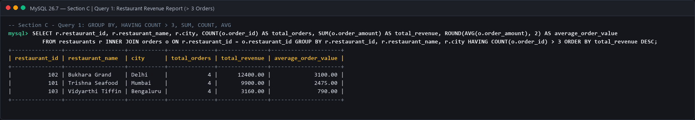
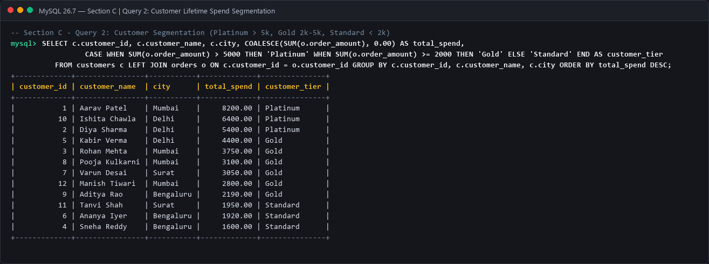
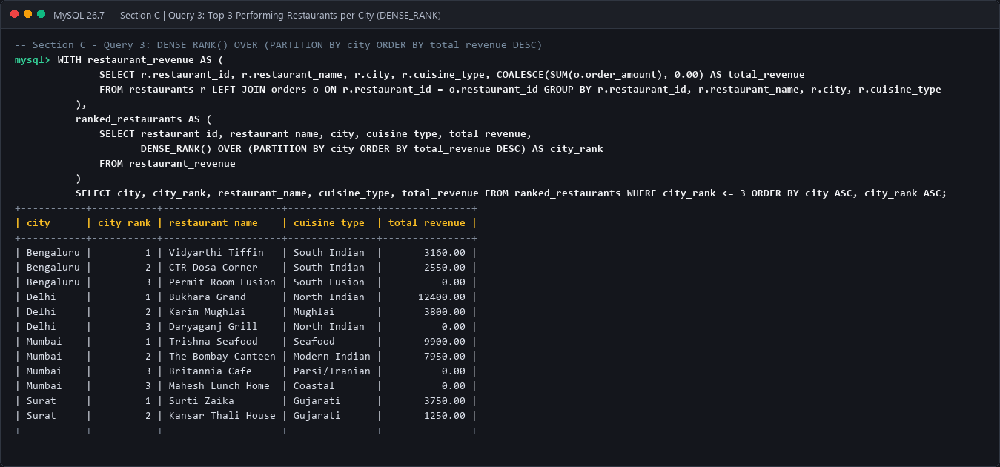
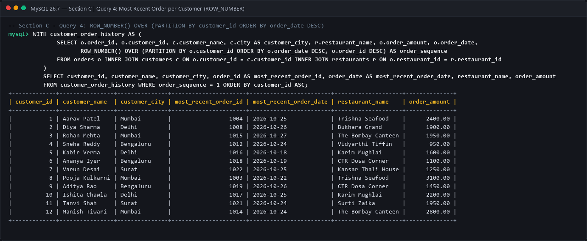
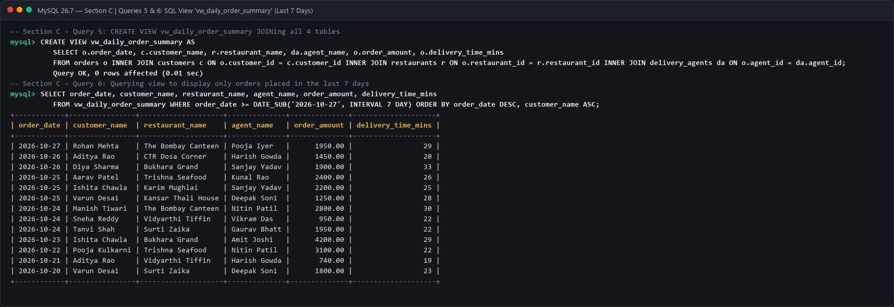

# Module 4: SQL for Data Analytics (M4-A1)
## Section C — Mini Capstone Project

**Project Name:** Food Delivery Analytics — SQL Backend  
**Program:** Data Analytics  
**Course Code:** M4-A1  
**Database Engine:** MySQL 8.0+ / 26.7+  
**Database Name:** `food_delivery_capstone`  

---

### 1. Executive Summary & Architecture Overview
The Food Delivery Analytics SQL Backend provides a multi-table relational schema designed to capture end-to-end food delivery logistics across multiple Indian metropolitan cities (Mumbai, Delhi, Bengaluru, and Surat).

#### Entity-Relationship Design:
```
 +-----------------+          +-----------------+
 |    CUSTOMERS    |          |   RESTAURANTS   |
 +-----------------+          +-----------------+
 | customer_id(PK) |          | restaurant_id(PK|
 | customer_name   |          | restaurant_name |
 | email (UNIQUE)  |          | cuisine_type    |
 | phone           |          | city            |
 | city            |          | rating          |
 | signup_date     |          +--------+--------+
 +--------+--------+                   |
          |                            |
          | 1                          | 1
          |                            |
          | N                          | N
 +--------+----------------------------+--------+
 |                     ORDERS                   |
 +----------------------------------------------+
 | order_id (PK)                                |
 | customer_id (FK) -> CUSTOMERS(customer_id)   |
 | restaurant_id (FK) -> RESTAURANTS(restaurant)|
 | agent_id (FK) -> DELIVERY_AGENTS(agent_id)   |
 | order_amount                                 |
 | delivery_time_mins                           |
 | order_status                                 |
 | order_date                                   |
 +----------------------+-----------------------+
                        | N
                        |
                        | 1
              +---------+---------+
              |  DELIVERY_AGENTS  |
              +-------------------+
              | agent_id (PK)     |
              | agent_name        |
              | phone             |
              | city              |
              | vehicle_type      |
              +-------------------+
```

---

### 2. Relational Schema Definition (DDL)
```sql
CREATE TABLE customers (
    customer_id INT PRIMARY KEY AUTO_INCREMENT,
    customer_name VARCHAR(100) NOT NULL,
    email VARCHAR(100) UNIQUE NOT NULL,
    phone VARCHAR(15) NOT NULL,
    city VARCHAR(50) NOT NULL,
    signup_date DATE NOT NULL
);

CREATE TABLE restaurants (
    restaurant_id INT PRIMARY KEY AUTO_INCREMENT,
    restaurant_name VARCHAR(100) NOT NULL,
    cuisine_type VARCHAR(50) NOT NULL,
    city VARCHAR(50) NOT NULL,
    rating DECIMAL(2,1) CHECK (rating >= 1.0 AND rating <= 5.0)
);

CREATE TABLE delivery_agents (
    agent_id INT PRIMARY KEY AUTO_INCREMENT,
    agent_name VARCHAR(100) NOT NULL,
    phone VARCHAR(15) NOT NULL,
    city VARCHAR(50) NOT NULL,
    vehicle_type VARCHAR(30) NOT NULL
);

CREATE TABLE orders (
    order_id INT PRIMARY KEY AUTO_INCREMENT,
    customer_id INT NOT NULL,
    restaurant_id INT NOT NULL,
    agent_id INT NOT NULL,
    order_amount DECIMAL(10,2) NOT NULL CHECK (order_amount > 0),
    delivery_time_mins INT NOT NULL CHECK (delivery_time_mins >= 0),
    order_status VARCHAR(20) NOT NULL DEFAULT 'Delivered',
    order_date DATE NOT NULL,
    CONSTRAINT fk_orders_customer FOREIGN KEY (customer_id) REFERENCES customers(customer_id) ON DELETE CASCADE,
    CONSTRAINT fk_orders_restaurant FOREIGN KEY (restaurant_id) REFERENCES restaurants(restaurant_id) ON DELETE CASCADE,
    CONSTRAINT fk_orders_agent FOREIGN KEY (agent_id) REFERENCES delivery_agents(agent_id) ON DELETE CASCADE
);
```

---

### 3. Analytics Query Suite & Results

#### Query 3.1: Restaurant Revenue Report (`GROUP BY`, `HAVING`, Aggregates)
- **Business Need**: Identify high-frequency partner restaurants (more than 3 fulfilled orders) and evaluate their financial performance.
- **SQL Implementation**:
```sql
SELECT 
    r.restaurant_id,
    r.restaurant_name,
    r.city,
    COUNT(o.order_id) AS total_orders,
    SUM(o.order_amount) AS total_revenue,
    ROUND(AVG(o.order_amount), 2) AS average_order_value
FROM restaurants r
INNER JOIN orders o ON r.restaurant_id = o.restaurant_id
GROUP BY 
    r.restaurant_id, 
    r.restaurant_name, 
    r.city
HAVING 
    COUNT(o.order_id) > 3
ORDER BY 
    total_revenue DESC;
```
- **Query Output Screenshot**:


---

#### Query 3.2: Customer Lifetime Value (LTV) Segmentation (`CASE WHEN`)
- **Business Need**: Classify customers into actionable loyalty tiers:
  - **Platinum**: Spend $> \text{Rs } 5,000$
  - **Gold**: Spend between $\text{Rs } 2,000 \text{ and } 5,000$
  - **Standard**: Spend $< \text{Rs } 2,000$
- **SQL Implementation**:
```sql
SELECT 
    c.customer_id,
    c.customer_name,
    c.city,
    COALESCE(SUM(o.order_amount), 0.00) AS total_spend,
    CASE 
        WHEN SUM(o.order_amount) > 5000 THEN 'Platinum'
        WHEN SUM(o.order_amount) >= 2000 THEN 'Gold'
        ELSE 'Standard'
    END AS customer_tier
FROM customers c
LEFT JOIN orders o ON c.customer_id = o.customer_id
GROUP BY 
    c.customer_id, 
    c.customer_name, 
    c.city
ORDER BY 
    total_spend DESC;
```
- **Query Output Screenshot**:


---

#### Query 3.3: Top 3 Performing Restaurants per City (`DENSE_RANK`)
- **Business Need**: Benchmark the top 3 revenue-generating restaurants within each city market.
- **SQL Implementation**:
```sql
WITH restaurant_revenue AS (
    SELECT 
        r.restaurant_id,
        r.restaurant_name,
        r.city,
        r.cuisine_type,
        COALESCE(SUM(o.order_amount), 0.00) AS total_revenue
    FROM restaurants r
    LEFT JOIN orders o ON r.restaurant_id = o.restaurant_id
    GROUP BY 
        r.restaurant_id, 
        r.restaurant_name, 
        r.city, 
        r.cuisine_type
),
ranked_restaurants AS (
    SELECT 
        restaurant_id,
        restaurant_name,
        city,
        cuisine_type,
        total_revenue,
        DENSE_RANK() OVER (
            PARTITION BY city 
            ORDER BY total_revenue DESC
        ) AS city_rank
    FROM restaurant_revenue
)
SELECT 
    city,
    city_rank,
    restaurant_name,
    cuisine_type,
    total_revenue
FROM ranked_restaurants
WHERE city_rank <= 3
ORDER BY 
    city ASC, 
    city_rank ASC;
```
- **Query Output Screenshot**:


---

#### Query 3.4: Single Most Recent Order per Customer (`ROW_NUMBER`)
- **Business Need**: Extract the latest transaction per registered customer to monitor last-order engagement.
- **SQL Implementation**:
```sql
WITH customer_order_history AS (
    SELECT 
        o.order_id,
        o.customer_id,
        c.customer_name,
        c.city AS customer_city,
        r.restaurant_name,
        o.order_amount,
        o.order_date,
        ROW_NUMBER() OVER (
            PARTITION BY o.customer_id 
            ORDER BY o.order_date DESC, o.order_id DESC
        ) AS order_sequence
    FROM orders o
    INNER JOIN customers c ON o.customer_id = c.customer_id
    INNER JOIN restaurants r ON o.restaurant_id = r.restaurant_id
)
SELECT 
    customer_id,
    customer_name,
    customer_city,
    order_id AS most_recent_order_id,
    order_date AS most_recent_order_date,
    restaurant_name,
    order_amount
FROM customer_order_history
WHERE order_sequence = 1
ORDER BY customer_id ASC;
```
- **Query Output Screenshot**:


---

#### Queries 3.5 & 3.6: Enterprise View Creation & Last 7 Days Filter
- **Business Need**: Provide an abstraction view joining all 4 core tables, and filter for recent operations (orders within the trailing 7 days).
- **SQL Implementation**:
```sql
-- Step 1: Create View
CREATE OR REPLACE VIEW vw_daily_order_summary AS
SELECT 
    o.order_date,
    c.customer_name,
    r.restaurant_name,
    da.agent_name,
    o.order_amount,
    o.delivery_time_mins
FROM orders o
INNER JOIN customers c ON o.customer_id = c.customer_id
INNER JOIN restaurants r ON o.restaurant_id = r.restaurant_id
INNER JOIN delivery_agents da ON o.agent_id = da.agent_id;

-- Step 2: Query View for Orders Placed in Last 7 Days
SELECT 
    order_date,
    customer_name,
    restaurant_name,
    agent_name,
    order_amount,
    delivery_time_mins
FROM vw_daily_order_summary
WHERE order_date >= DATE_SUB('2026-10-27', INTERVAL 7 DAY)
ORDER BY order_date DESC, customer_name ASC;
```
- **Query Output Screenshot**:


---
*End of Section C — Mini Capstone Project*
