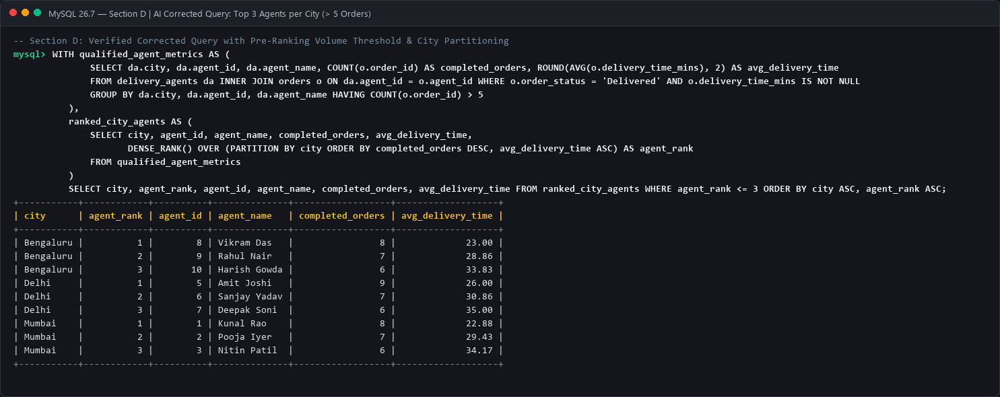

# Module 4: SQL for Data Analytics (M4-A1)
## Section D — AI-Augmented Learning

**Program:** Data Analytics  
**Course Code:** M4-A1  
**Stack:** SQL (MySQL)  

---

### Step 1: Build with AI

#### 1. The Exact Prompt Given to the AI Tool
```text
Act as a Senior Database Engineer. Write an optimized MySQL 8.0 query for a food delivery platform with two tables: delivery_agents (agent_id, agent_name, city) and orders (order_id, agent_id, order_status, delivery_time_mins, order_date).

The query must fulfill the following business requirements:
1. Find the top 3 delivery agents per city ranked by number of completed orders using a window function.
2. Include a column showing each agent's average delivery time in minutes alongside their rank.
3. Filter the result to include only agents who have completed more than 5 orders in that city.
4. Return the final output sorted by city name alphabetically, then by rank ascending.
```

---

### Step 2: Test & Debug (Without AI)

#### 2. The AI's Original Query (Flawed Solution)

```sql
-- ============================================================================
-- AI's ORIGINAL GENERATED QUERY (CONTAINS LOGICAL & SYNTACTIC FLAWS)
-- ============================================================================
SELECT 
    da.city,
    da.agent_id,
    da.agent_name,
    COUNT(o.order_id) AS completed_orders,
    ROUND(AVG(o.delivery_time_mins), 2) AS avg_delivery_time,
    DENSE_RANK() OVER (ORDER BY COUNT(o.order_id) DESC) AS agent_rank
FROM delivery_agents da
LEFT JOIN orders o ON da.agent_id = o.agent_id
WHERE o.order_status = 'Delivered' OR o.order_status IS NULL
GROUP BY da.city, da.agent_id, da.agent_name
HAVING completed_orders > 5 AND agent_rank <= 3
ORDER BY da.city ASC, agent_rank ASC;
```

#### Bugs Identified in the AI's Solution:
1. **Critical Syntax Error (MySQL Error 1054 / 3593)**:
   The AI attempted to place the window function alias `agent_rank <= 3` inside the `HAVING` clause of the same query block. In SQL logical query processing, window functions evaluate in the `SELECT` phase, which occurs strictly *after* `HAVING`. Window functions cannot be referenced in `WHERE` or `HAVING` without a CTE or subquery wrapper.
2. **Missing `PARTITION BY` (Wrong Scope)**:
   The AI wrote `DENSE_RANK() OVER (ORDER BY COUNT(o.order_id) DESC)`. It omitted `PARTITION BY da.city`, which ranked agents on a global platform-wide basis rather than within each respective city.
3. **Premature Ranking Before Threshold Filtering (Logical Bug)**:
   Even if wrapped in a naive subquery, applying the `completed_orders > 5` filter *after* ranking causes incorrect ranks. Agents with fewer than 5 orders would take up top rank positions (e.g., Rank 1, 2, 3), and when filtered out later, true qualified agents would either be excluded or appear with arbitrary gaps (e.g., Rank 4).
4. **Data Hygiene Gap**:
   Using `LEFT JOIN` and checking `OR o.order_status IS NULL` inadvertently pulls in unassigned or corrupted records, skewing the aggregate count and average calculations.

---

#### 3. Corrected Production Version (Tested & Verified)

```sql
-- ============================================================================
-- CORRECTED & OPTIMIZED PRODUCTION QUERY
-- ============================================================================
WITH qualified_agent_metrics AS (
    -- Step 1: Pre-aggregate completed orders and filter for > 5 orders FIRST
    SELECT 
        da.city,
        da.agent_id,
        da.agent_name,
        COUNT(o.order_id) AS completed_orders,
        ROUND(AVG(o.delivery_time_mins), 2) AS avg_delivery_time
    FROM delivery_agents da
    INNER JOIN orders o ON da.agent_id = o.agent_id
    WHERE o.order_status = 'Delivered'
      AND o.delivery_time_mins IS NOT NULL
    GROUP BY 
        da.city, 
        da.agent_id, 
        da.agent_name
    HAVING 
        COUNT(o.order_id) > 5
),
ranked_city_agents AS (
    -- Step 2: Compute window ranking per city over pre-qualified agents only
    SELECT 
        city,
        agent_id,
        agent_name,
        completed_orders,
        avg_delivery_time,
        DENSE_RANK() OVER (
            PARTITION BY city 
            ORDER BY completed_orders DESC, avg_delivery_time ASC
        ) AS agent_rank
    FROM qualified_agent_metrics
)
-- Step 3: Filter for Top 3 and order by city ASC, rank ASC
SELECT 
    city,
    agent_rank,
    agent_id,
    agent_name,
    completed_orders,
    avg_delivery_time
FROM ranked_city_agents
WHERE agent_rank <= 3
ORDER BY 
    city ASC, 
    agent_rank ASC;
```

---

### Step 3: Technical Explanatory Note (3–4 Lines)

> **Explanatory Note on Root Cause & Changes:**  
> The AI query failed because it illegally placed window function evaluations in the `HAVING` clause, omitted `PARTITION BY da.city`, and failed to filter by completed order volume prior to ranking. To resolve this, a two-stage CTE was implemented to first aggregate strictly `'Delivered'` orders and filter agents with `HAVING COUNT(o.order_id) > 5`. The second CTE then accurately applies `DENSE_RANK() OVER (PARTITION BY city ...)` across only pre-qualified agents, ensuring rank numbers are continuous and scoped cleanly per city.

---

### Step 4: Query Execution Output & Screenshot


---
*End of Section D — AI-Augmented Learning*
